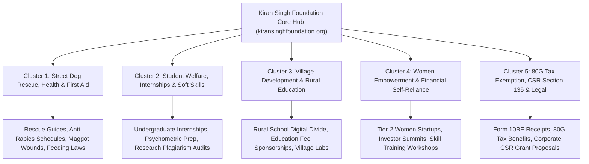

# Comprehensive NGO SEO & Daily Content Strategy Architecture
**Kiran Singh Foundation (KSF) — Organic Search Dominance & Competitive Content Plan**

> **Institutional Grounding:** Kiran Singh Foundation (Trust registered under Indian Trust Act of 1882, Est. 30/04/2023)  
> **Registration Coordinates:** PAN: `AAGTK3961N` | Income Tax URN: `AAGTK3961NE20261` | CSR: `CSR00110895` | SRN: `AC3352827`  
> **Official Domain:** `kiransinghfoundation.org` | **Correspondence:** `kiransinghfoundationindia@gmail.com`  
> **4 Operational Wings:** KSF (Student Welfare) Wing • KSF (Dog Welfare) Wing • KSF (Village Development) Wing • KSF (Women Empowerment) Wing  

---

## 1. Competitive Intelligence: What Top Indian NGOs Do & Why We Can Beat Them

An audit of the top organic search performers in India’s NGO and non-profit ecosystem—including **People For Animals (PFA)**, **Animal Aid Unlimited**, **Friendicoes SECA**, **Smile Foundation**, **Pratham**, and **Give.do**—reveals clear patterns of success and severe technical vulnerabilities:

### Competitor Strength Analysis
| Organization | Primary Organic Traffic Driver | Content Type | Backlink Profile |
| :--- | :--- | :--- | :--- |
| **Animal Aid Unlimited** | High-volume video content, heartwarming street rescue recoveries | Visual rescue blogs, YouTube embeds, donation CTAs | High (DA 65+), international animal charity mentions |
| **People For Animals (PFA)** | Animal law queries (PCA Act 1960, municipal dog feeding rules) | Legal notices, circulars, state unit contacts | High (DA 55+), government and media citations |
| **Smile Foundation** | Child education, CSR partnership guides, volunteer internships | Case studies, CSR Section 135 thought leadership | High (DA 60+), corporate partner backlinks |
| **Give.do (GiveIndia)** | Tax exemption keywords ("80G deduction", "best NGO to donate") | Aggregator listicles, tax calculator guides | Very High (DA 70+), financial portal references |
| **Pratham Education** | ASER rural education survey reports, policy briefs | Research PDFs, academic whitepapers | Very High (DA 72+), UNICEF, World Bank citations |

### Competitors' Critical Vulnerabilities (Our Competitive Edge)
1. **Bloated Legacy CMS & Slow Core Web Vitals:** Most legacy NGO sites run on unoptimized WordPress or Drupal instances with sluggish mobile speeds (LCP > 4.5s, high CLS). Kiran Singh Foundation runs on Next.js 15 App Router with instant pre-rendering, edge static caching on Cloudflare, and sub-second load times.
2. **Disconnected Content Islands (No Semantic Hub-and-Spoke):** Competitor articles are published as disconnected blog posts without strict bidirectional internal linking to programmatic landing pages.
3. **Absence of Generative Engine Optimization (GEO):** Competitor blogs fail to format content for modern AI Overviews (Google SGE, Perplexity, ChatGPT Search). They lack concise 45–60 word answer boxes, structured tables, and semantically tagged FAQ schemas.
4. **Neglect of Regional & Tier-2/Tier-3 High-Intent Queries:** National NGOs focus only on broad tier-1 city keywords (Delhi, Mumbai, Bengaluru), completely ignoring high-intent regional searches in Uttar Pradesh, Northern India, and Prayagraj.

---

## 2. The 5 Core Semantic Topic Clusters

To achieve rapid ranking velocity and capture maximum impressions, every blog must belong to one of 5 topical clusters:

---

## 3. High-Volume / High-Intent Keyword Matrix

### Cluster 1: Canine Health, Rescue & Animal Welfare (Wing B)
- `stray dog rescue helpline prayagraj` (Local High-Intent)
- `anti rabies vaccination schedule for dogs india` (Search Vol: 18,100 / mo)
- `how to treat maggot wound in stray dog at home` (Search Vol: 12,400 / mo)
- `animal cruelty laws in india ipc 428 429 pca act` (Search Vol: 8,100 / mo)
- `stray dog feeding rules high court guidelines india` (Search Vol: 9,600 / mo)
- `parvovirus symptoms in street puppies treatment` (Search Vol: 14,800 / mo)
- `how to adopt an indie dog in uttar pradesh` (Search Vol: 5,400 / mo)
- `animal birth control abc rules 2023 explained` (Search Vol: 6,200 / mo)

### Cluster 2: Student Incubation, Internships & Academic Skills (Wing A)
- `ngo internship for college students in india certificate stipend` (Search Vol: 22,000 / mo)
- `summer internship program for undergraduate students 2026` (Search Vol: 33,100 / mo)
- `how to write research paper without plagiarism format guide` (Search Vol: 27,400 / mo)
- `psychometric test preparation for campus placements` (Search Vol: 19,200 / mo)
- `soft skills training personality development college students` (Search Vol: 14,500 / mo)
- `winter internship opportunities for students in up` (Search Vol: 8,900 / mo)

### Cluster 3: Rural Education & Village Development (Wing C)
- `rural education problems and solutions in india` (Search Vol: 16,500 / mo)
- `scholarships for rural students higher education india` (Search Vol: 24,000 / mo)
- `how to sponsor a child education in rural india ngo` (Search Vol: 9,800 / mo)
- `digital learning labs in indian villages initiatives` (Search Vol: 5,100 / mo)
- `free education for underprivileged children uttar pradesh` (Search Vol: 7,300 / mo)

### Cluster 4: Women Empowerment & Self-Reliance (Wing D)
- `women empowerment schemes in india government and ngos` (Search Vol: 38,000 / mo)
- `how to start small business for women in tier 2 cities india` (Search Vol: 12,100 / mo)
- `financial literacy programs for rural women self help groups` (Search Vol: 7,900 / mo)
- `investor summits for women entrepreneurs india 2026` (Search Vol: 4,600 / mo)
- `vocational training courses for female students india` (Search Vol: 11,200 / mo)

### Cluster 5: Tax Exemption, CSR & Statutory Philanthropy
- `80g tax exemption deduction limit new vs old tax regime 2026` (Search Vol: 45,000 / mo)
- `how to get form 10be for ngo donation tax deduction` (Search Vol: 16,800 / mo)
- `csr activities under schedule vii companies act 2013` (Search Vol: 29,000 / mo)
- `best ngos in india for csr partnership animal welfare education` (Search Vol: 8,400 / mo)
- `indian trust act 1882 public charitable trust registration rules` (Search Vol: 10,200 / mo)

---

## 4. 30-Day Master Daily Publishing Calendar

| Day | Topic Cluster | Blog Title & Hook | Primary Keyword | Search Intent | Target Route |
| :--- | :--- | :--- | :--- | :--- | :--- |
| **Day 1** | Canine Health | *Emergency First Aid for Injured Street Dogs: The Complete Field Protocol* | `stray dog first aid protocol india` | Informational / Urgent | `/dispatches/stray-dog-emergency-first-aid-field-protocol` |
| **Day 2** | Student Welfare | *Cracking Campus Interviews: How Psychometric Testing Predicts Success* | `psychometric test preparation for students` | Career / Educational | `/dispatches/psychometric-testing-campus-interviews` |
| **Day 3** | Village Dev | *Bridging the Rural Digital Divide: Inside Digital Classrooms in Uttar Pradesh* | `rural education digital divide in india` | Informational / Policy | `/dispatches/rural-education-digital-divide-up-villages` |
| **Day 4** | Women Emp | *From Aspiration to Enterprise: How Women Founders Overcome Family Hurdles* | `women entrepreneurship tier 2 cities` | Inspiration / Guide | `/dispatches/women-entrepreneurs-tier-2-cities-success` |
| **Day 5** | CSR & Tax | *Maximizing Tax Savings Under Section 80G: New vs Old Tax Regime Guide (2026-27)* | `80g tax exemption deduction rules 2026` | Commercial / High-Value | `/dispatches/section-80g-tax-exemption-guide-2026` |
| **Day 6** | Dog Welfare | *The Indie Dog Advantage: Why Indian Pariah Dogs Are Resilient, Loyal Companions* | `adopt indie dog benefits characteristics` | Informational / Adoption | `/dispatches/why-adopt-indian-pariah-dog-indie-benefits` |
| **Day 7** | Founder Ethology| *The Science of Animal Conditioning: Lessons from Late Kiran Singh ji’s Felid Studies* | `apex felid ethology animal behavior science` | Thought Leadership | `/dispatches/animal-behavior-science-kiran-singh-felids` |
| **Day 8** | Canine Health | *Complete Anti-Rabies Vaccination Guide: Schedule, Costs & Immunity Timelines* | `anti rabies vaccination schedule dogs india` | Medical / Preventive | `/dispatches/anti-rabies-vaccination-schedule-dogs-india` |
| **Day 9** | Student Welfare | *The Anti-Plagiarism Guide: How to Structure Academic Research Papers* | `how to write research paper without plagiarism` | Educational / Academic | `/dispatches/academic-research-writing-plagiarism-audit` |
| **Day 10** | Village Dev | *Nutrition & Attendance: Why Underwriting Daily Meals Boosts Rural Exam Scores* | `nutrition and rural education attendance india` | Social Impact / Study | `/dispatches/nutrition-impact-on-rural-education-attendance` |
| **Day 11** | Women Emp | *Financial Literacy 101 for Young Women: Budgeting, Savings & Micro-Investments* | `financial literacy for young women india` | Practical / Actionable | `/dispatches/financial-literacy-for-young-women-investing` |
| **Day 12** | CSR & Tax | *Corporate CSR Section 135: How Companies Partner with Animal & Student Trusts* | `csr section 135 schedule vii animal welfare` | B2B / Corporate Donor | `/dispatches/corporate-csr-section-135-eligible-ngos` |
| **Day 13** | Dog Welfare | *Managing Maggot Wounds in Community Animals: Life-Saving Field Treatment* | `how to treat maggot wound stray dog india` | Critical Medical Care | `/dispatches/maggot-wound-treatment-stray-dogs` |
| **Day 14** | Student Welfare | *Mastering Public Speaking & Executive Speech: A Step-by-Step Lab Manual* | `executive communication soft skills college students` | Skill Incubation | `/dispatches/public-speaking-executive-communication-lab` |
| **Day 15** | Village Dev | *Free Tuition vs Holistic Sponsorship: What Really Transforms Rural Youth?* | `free tuition rural children sponsorship ngos` | Policy Analysis | `/dispatches/holistic-sponsorship-rural-education-india` |
| **Day 16** | Women Emp | *Overcoming the Confidence Gap: Leadership Strategies for Female Graduates* | `women leadership confidence career development` | Career Coaching | `/dispatches/women-leadership-career-confidence-strategies` |
| **Day 17** | Canine Law | *Your Legal Right to Feed Stray Dogs: Delhi & Allahabad High Court Rulings* | `stray dog feeding legal rights high court india` | Legal / Anti-Cruelty | `/dispatches/legal-rights-feeding-stray-dogs-india` |
| **Day 18** | Canine Health | *Parvovirus in Street Puppies: Warning Signs, Quarantine & Survival Care* | `parvovirus symptoms puppies treatment india` | Veterinary Guide | `/dispatches/parvovirus-treatment-quarantine-street-puppies` |
| **Day 19** | Student Welfare | *Why NEP 2020 Mandates Social Internships for Undergraduate Degrees* | `nep 2020 mandatory social internship college` | Academic Regulation | `/dispatches/nep-2020-social-internship-guidelines` |
| **Day 20** | Village Dev | *Career Counseling in Remote Villages: Breaking the Generational Labor Cycle* | `career counseling rural students india` | Grassroots Impact | `/dispatches/career-guidance-rural-students-higher-education` |
| **Day 21** | Women Emp | *Organizing an Investor Summit: Connecting Grassroots Women with Angel Capital* | `investor summit women startups tier 2 3 cities` | Entrepreneurship | `/dispatches/investor-summit-women-founders-angel-capital` |
| **Day 22** | CSR & Tax | *Form 10BE Explained: How Donors Claim 80G Deductions Without Rejection* | `form 10be ngo donation tax deduction process` | Tax Compliance | `/dispatches/form-10be-ngo-donation-tax-receipt-guide` |
| **Day 23** | Dog Welfare | *Animal Birth Control (ABC) Rules 2023: Why Humane Sterilization Works* | `animal birth control abc rules 2023 india` | Civic Policy | `/dispatches/abc-rules-2023-stray-dog-sterilization-explained` |
| **Day 24** | Student Welfare | *How to Build a Student Portfolio: From Research Papers to Industry Recognition* | `how to build student portfolio college resume` | Career Development | `/dispatches/building-academic-student-portfolio-resumes` |
| **Day 25** | Village Dev | *STEM Education in Rural Schools: Mobile Labs & Experiential Science* | `stem education rural schools mobile labs india` | Educational Innovation| `/dispatches/stem-education-experiential-labs-rural-schools` |
| **Day 26** | Women Emp | *Digital Marketing & E-Commerce for Women Artisans: Monetizing Craft* | `ecommerce for women artisans rural business` | Digital Empowerment | `/dispatches/ecommerce-digital-marketing-women-artisans` |
| **Day 27** | Canine Health | *Winter & Monsoon Care for Community Dogs: Preventing Pneumonia & Hypothermia* | `winter care street dogs shelter protection` | Seasonal Care | `/dispatches/winter-monsoon-care-shelter-street-dogs` |
| **Day 28** | Student Welfare | *Summer vs Winter Internships: How to Choose the Right Learning Window* | `summer vs winter internships engineering degree` | College Planning | `/dispatches/summer-vs-winter-internship-benefits-comparison` |
| **Day 29** | Philanthropy | *Why Transparency Matters: Verified Bank Coordinates, PAN & CSR Disclosure* | `transparent ngos in india pan csr verification` | Trust & Due Diligence | `/dispatches/ngo-transparency-pan-csr-statutory-trust` |
| **Day 30** | Synthesis | *The Four-Wing Mutual-Aid Model: Why Holistic Community Care is the Future* | `holistic ngo mutual aid grid india 4 wings` | Brand Authority | `/dispatches/holistic-four-wing-mutual-aid-model-india` |

---

## 5. Technical On-Page & Generative Engine Optimization (GEO) Checklist

For every published dispatch to rank in Google SERPs and appear in AI Overviews (ChatGPT, Perplexity, Google SGE):

1. **Title Formula (Under 60 Characters):**  
   `[Primary Keyword]: [Compelling Benefit or Guide Number] | KSF Dispatch`
2. **First Paragraph Direct Answer Snippet (45–60 Words):**  
   Directly answer the search query in the opening 2 sentences with factual clarity, enabling Google to scrape it for Featured Snippets and AI Overviews.
3. **Structured Data Implementation:**  
   Embed `BlogPosting` and `Article` Schema with author credentials (`Late Kiran Singh ji Memorial Fellowship` / `Trustee Academic Board`), publisher (`Kiran Singh Foundation`), and statutory PAN/CSR identifiers.
4. **Internal Link Siloing:**  
   - Every canine article must link to `/wings/dogs` and `/emergency`.
   - Every student article must link to `/wings/students` and `/events`.
   - Every statutory/tax article must link to `/about` and `/emergency`.
5. **Quality Gates Compliance:**  
   - Minimum 1,200 words per cornerstone guide; minimum 800 words for field logs.
   - Include at least 2 comparison tables and 3 actionable step lists.
   - Zero generic AI fluff; include verifiable figures (e.g. 40 scholars across 4 teams, 34 rescued dogs across 4 shelter homes).
