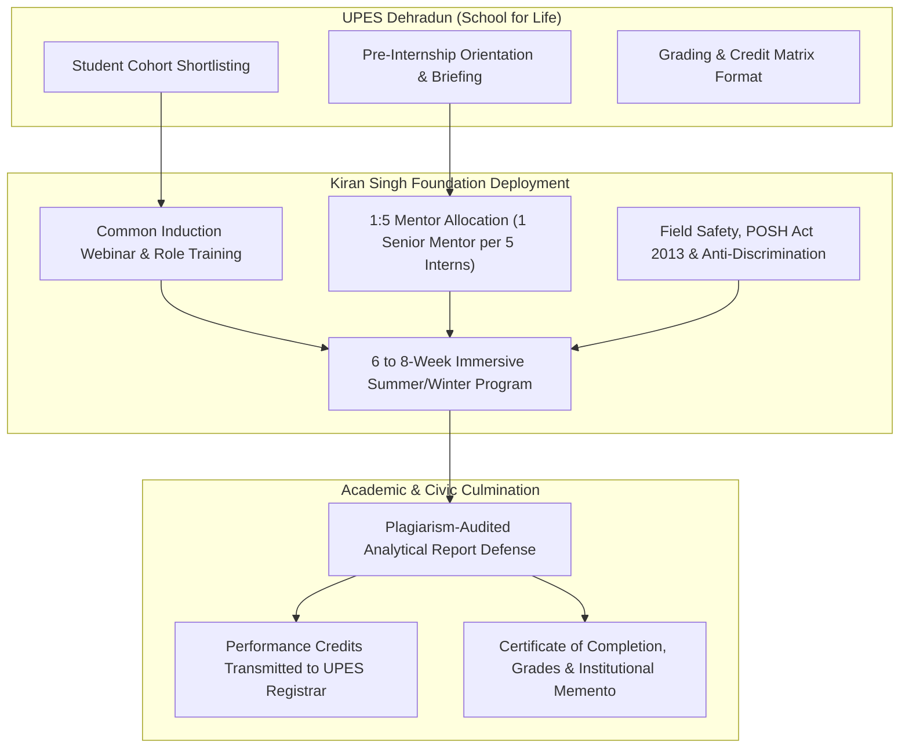

# Institutional Research Dossier: UPES Dehradun & Kiran Singh Foundation MoU
## Academic Collaboration Charter — "School for Life" Pro-Bono Internship Framework
**Document Reference:** `KSF-RES-MOU-UPES-2026-01`  
**Classification:** Primary Legal & Statutory Research Audit  
**Author:** Executive Creative Director & Principal Full-Stack Architect  
**Primary Source:** Official Bilateral Memorandum of Understanding & Government of Uttarakhand e-Stamp Certificate (`IN-UK09052749976330X`)  
**Status:** Executed, Sealed, and Statutorily Binding  

---

## 1. Statutory Identification & Instruments of Execution

| Instrument Attribute | Primary Source Verification | Legal & Operational Significance |
| :--- | :--- | :--- |
| **Jurisdiction & Instrument** | Government of Uttarakhand e-Stamp Certificate | Executed on non-judicial stamp paper in Dehradun under the Indian Stamp Act. |
| **Certificate Number** | `IN-UK09052749976330X` | Verifiable on the official e-Stamping verification portal (ShcilEStamp). |
| **e-Stamp Issue Date** | 25-Jul-2025 06:51 AM | Official purchase timestamp by UPES treasury. |
| **Unique Doc. Reference** | `SUBIN-UKUK129890424840684099060X` | Cryptographic reference code tied to Dehradun registry. |
| **Account Reference** | `NONACC (SV)/ uk1298904/ DEHRADUN/ UK-DH` | Dehradun District sub-registrar account. |
| **Stamp Duty Paid** | ₹100 (One Hundred Rupees) | Article 5 Agreement / Memorandum of an Agreement. |
| **Executing Parties** | First Party: **UPES** Second Party: **Kiran Singh Foundation** | Bilateral execution between higher educational institution and Section 8 non-profit company. |
| **Effective Date of MoU** | **13th Day of April 2026** | Binding inception date governing active cohorts. |
| **Tenure & Expiration** | **5 Years (Expiring 12th April 2031)** | Long-term programmatic horizon with 90-day written termination clause. |

---

## 2. Institutional Parties & Authorized Signatories

### 2.1 First Party: The University of Petroleum and Energy Studies (UPES)
- **Statutory Foundation:** Established under the *University of Petroleum and Energy Studies Act, 2003*, enacted by the Legislature of the State of Uttarakhand, India.
- **Main Campus:** Villages Bidholi, via Prem Nagar, Dehradun, Uttarakhand, PIN: 248007, India.
- **Authorized Signatory:** **Mr. Manish Madaan**, Registrar, UPES.
- **Institutional Seal:** Blue circular official stamp: `UPES REGISTRAR DEHRADUN`.

### 2.2 Second Party: Kiran Singh Foundation (KSF)
- **Corporate Entity:** Registered Section 8 Non-Profit Company (Private Company limited by guarantee) under the Indian Companies Act, 2013.
- **Registered Office:** 191/C Tilak Nagar Allahpur, Prayagraj, Uttar Pradesh, PIN: 211006, India.
- **Authorized Signatory:** **Shri Anuj Kumar Singh**, Manager / Secretary.

---

## 3. Core Programmatic Framework: The "School for Life"

### 3.1 Objective & Philosophical Alignment
The collaboration is situated within UPES's flagship **"School for Life"** academic curriculum. This program is engineered to:
- Instill societal awareness, ethical citizenship, and grassroots civic responsibility in undergraduate students.
- Deploy UPES students as field and research interns directly into the operational wings of Kiran Singh Foundation.
- Connect academic theory with real-world public welfare (Student Welfare mentoring, street canine care, rural village education, and mutual-aid triage).

### 3.2 Pro-Bono Integrity Mandate
- **Strict Pro-Bono Clause (Clause 4 & Preamble):** Neither institution shall charge, bill, or seek reimbursement of any fee, stipend, or overhead cost from the other or from the students.
- **Fundraising Prohibition (Clause 3.A.11):** Interns are explicitly shielded from commercialization. Kiran Singh Foundation is legally barred from engaging interns in any crowdfunding, fundraising, or financial solicitation activities.
- **Travel Expense Coverage (Clause 3.A.8):** If students travel outside the district or state for Foundation work, all travel costs are fully borne by Kiran Singh Foundation.

---

## 4. Operational & Pedagogical Guarantees

### 4.1 The 1:5 Mentorship Ratio (Clause 3.A.7)
Kiran Singh Foundation guarantees that for every **5 student interns**, at least **one dedicated senior mentor** is formally assigned. This prevents interns from becoming lost in unstructured NGO tasks and guarantees rigorous academic and technical steering.

### 4.2 Duration & Academic Calendar (Clause 3.A.9)
- **Duration:** 6 to 8 weeks.
- **Primary Window:** Preferred during June and July (synchronizing with the Foundation’s landmark 2nd Summer Internship Program in June 2026 and future summer cycles).
- **Non-Discontinuation Guarantee (Clause 3.A.12):** Once an internship commences, KSF cannot prematurely abort or discontinue the student's program.

### 4.3 Student Safety & Regulatory Protections
- **POSH Act 2013 Compliance (Clause 3.A.4):** The *Sexual Harassment of Women at Workplace (Prevention, Prohibition and Redressal) Act, 2013* and anti-discrimination policies of KSF apply *ipso facto* to all UPES interns.
- **Data Protection & Privacy (Clause 3.A.6):** Strict confidentiality shielding interns' personal, demographic, contact, and academic information.

---

## 5. Intellectual Property & Brand Alignment

### 5.1 Mutual Logo Authorization (Clause 5)
Clause 5 explicitly authorizes both institutions to utilize each other’s institutional name and official logos solely for promoting and administering collaborative academic programs.

### 5.2 UPES Official Visual Identity
- **Mark:** Stylized multicolour geometric 'U' shield (cyan, magenta, yellow, blue gradient stripes) alongside the bold black sans-serif logotype **UPES**.
- **Usage Standard:** Displayed alongside Kiran Singh Foundation's roaring lion boxed seal, set on hairline porcelain card containers (`border-neutral-200`) with high-end luxury editorial spacing.

---

## 6. Dispute Resolution & Statutory Mechanics

- **Governing Law:** Laws of the Republic of India.
- **Arbitration Framework:** Under the *Arbitration and Conciliation Act, 1996*.
- **Arbitrator:** Sole Arbitrator mutually appointed by the parties.
- **Seat & Venue:** Dehradun, Uttarakhand.
- **Official Language:** English.
- **Exit Clause:** Either party may terminate the agreement upon giving **90 days advance written notice** without impacting ongoing student obligations.

---

## 7. Strategic Conclusions for the Platform

This executed MoU provides rock-solid institutional validation for the Kiran Singh Foundation:
1. **Accredited Academic Validation:** Moves the Student Welfare Wing from self-funded patronage to an accredited university partner tier (UPES "School for Life").
2. **Pedagogical Structure:** The 1:5 mentorship ratio and 6–8 week curriculum structure directly mirror the Foundation's existing 4-team defense model and corporate internship framework.
3. **Public Presentation:** The UPES collaboration should be given a prominent, high-end editorial presence on the platform—elevating institutional credibility for prospective donors, scholars, and academic bodies.
