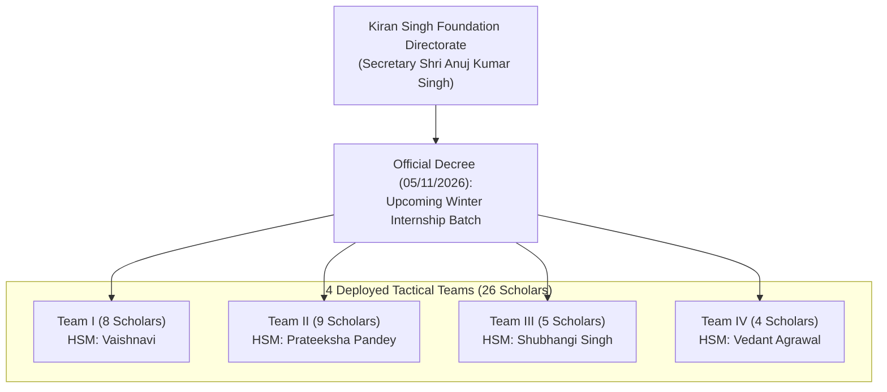

# Official Decree & Operational Roster: Upcoming Winter Internship Batch (2026–27)

> **Primary Source Document:** Official Executed Letterhead Notification — *FINAL LIST FOR UPCOMING INTERNSHIP PROGRAM :-*  
> **Issuing Authority:** Secretary Shri Anuj Kumar Singh, Kiran Singh Foundation  
> **Document Date:** 05/11/2026 (5th November 2026)  
> **Place of Execution:** Prayagraj, Uttar Pradesh  
> **Physical Asset Reference:** `public/images/events/winter-2026-27/final-list-upcoming-internship-decree.jpg`  

---

## 1. Institutional Metadata & Communications Verification

The decree was executed on the official institutional letterhead of the Foundation, confirming primary operational credentials:

| Institutional Field | Primary Source Value | Verification Notes |
| :--- | :--- | :--- |
| **Foundation Name** | **KIRAN SINGH FOUNDATION** | Registered under Indian Trust Act of 1882 |
| **Institutional Motto** | *'A Journey from struggle to Enlightenment'* | Archival founding precept |
| **Registered Secretariat** | **191/C, Tilak Nagar Allahpur Prayagraj** | Allahabad / Prayagraj, U.P. – 211006 |
| **Official Contact Hotlines** | **8004862107** &bull; **9670970750** | Primary dispatch & secretary contact lines |
| **Direct Secretariat Email** | `ankus0102@gmail.com` | Institutional executive correspondence |
| **Official UPI Settlement ID** | `9670970750@ybl` | Verified digital banking handle |
| **Decree Date** | **05/11/2026** (5th November 2026) | Certified by Secretary Shri Anuj Kumar Singh |

---

## 2. Cohort Telemetry: Upcoming Winter Internship Batch

While the Foundation's statutory scholarship endowment maintains an overall capacity of **40 scholars** (with **37 active enrolled scholars** across the 2026–27 session), this official notification constitutes the **active deployment roster of 26 selected scholars** mobilized for the **Upcoming Winter Internship Program (2026–27)**.

### Statistical Summary
* **Total Mobilized Scholars:** **26**
* **Active Operational Teams:** **04 Teams** (Team I through Team IV)
* **Command Structure:** 4 appointed **Head Superintendent Managers (HSMs)** written in red ink
* **Academic Continuity:** 100% of participants map to the active `KSF-STU` matriculation database

---

## 3. Exhaustive Team-Wise Roster & Database Cross-Reference

### Team I (8 Scholars)
* **Supervisory Command:** **Vaishnavi (HSM)** *(Head Superintendent Manager)*
* **Research Focus:** Governance, Public Administration & Institutional Advocacy

| S.No. | Matriculation ID | Student Name (Decree) | Database Official Name | Academic Background / Discipline |
| :---: | :---: | :--- | :--- | :--- |
| 1 | `KSF-STU-013` | **Vaishnavi (HSM)** | Vaishnavi | Head Superintendent Manager (HSM) |
| 2 | `KSF-STU-020` | **Aarya Srivastava** | Aarya Srivastava | Economics & Public Policy Analysis |
| 3 | `KSF-STU-015` | **Anwesha Sinha** | Anwesha Sinha | International Humanitarian Law & Human Rights *(Team Leader Honors)* |
| 4 | `KSF-STU-018` | **Swarnima Singh** | Swarnima Singh | English Literature & Critical Cultural Studies |
| 5 | `KSF-STU-017` | **Shubhi Singh** | Shubhi Singh | Environmental Science & Sustainable Development |
| 6 | `KSF-STU-016` | **Vanya Singh** | Vanya Singh | Political Science & Constitutional Governance |
| 7 | `KSF-STU-019` | **Karan Pal** | Karan Pal | Business Administration & Corporate Strategy |
| 8 | `KSF-STU-023` | **Annanya Arora** | Annanya Arora | Sociology & Rural Development Studies |

---

### Team II (9 Scholars)
* **Supervisory Command:** **Prateeksha Pandey (HSM)** *(Head Superintendent Manager)*
* **Research Focus:** Legal Jurisprudence, Civic Rights & Statutory Welfare

| S.No. | Matriculation ID | Student Name (Decree) | Database Official Name | Academic Background / Discipline |
| :---: | :---: | :--- | :--- | :--- |
| 1 | `KSF-STU-024` | **Prateeksha Pandey (HSM)** | Prateeksha Pandey | Head Superintendent Manager (HSM) |
| 2 | `KSF-STU-031` | **Varnika Mishra** | Varnika Mishra | Environmental Law & Public Interest Litigation *(Team Leader Honors)* |
| 3 | `KSF-STU-026` | **Yashaswa Singh** | Yashaswa Singh | Corporate Law & Governance Compliance |
| 4 | `KSF-STU-027` | **Saksham Agrawal** | Saksham Agrawal | Economics & Public Finance Analysis |
| 5 | `KSF-STU-030` | **Stuti Singh** | Stuti Singh | International Relations & Diplomatic Protocols |
| 6 | `KSF-STU-033` | **Navleen Kaur Puri** | Navleen Kaur Puri | Psychology & Behavioral Counseling Science |
| 7 | `KSF-STU-028` | **Aleen Chaurasia** | Alien Chaurasia | Political Science & Social Policy Research |
| 8 | `KSF-STU-032` | **Parinita Bhushan** | Parinita Bhushan | Journalism & Mass Communications Ethics |
| 9 | `KSF-STU-029` | **Mansi Raj Purwar** | Mansi Raj Purwar | Commerce & Fiscal Audit Accounting |

---

### Team III (5 Scholars)
* **Supervisory Command:** **Shubhangi Singh (HSM)** *(Elevated from Dy. HSM to Head Superintendent Manager)*
* **Research Focus:** Grassroots Community Development, Youth Literacy & Societal Awareness

| S.No. | Matriculation ID | Student Name (Decree) | Database Official Name | Academic Background / Discipline |
| :---: | :---: | :--- | :--- | :--- |
| 1 | `KSF-STU-034` | **Shubhangi Singh (HSM)** | Shubhangi Singh | Head Superintendent Manager (HSM) |
| 2 | `KSF-STU-003` | **Stuti Dwivedi** | Stuti Dwivedi | Team Leader & Oratory Specialist *(Casio Convocation Artist)* |
| 3 | `KSF-STU-005` | **Luvleen Kaur Puri** | Luvleen Kaur Puri | Clinical Psychology & Counseling Dynamics |
| 4 | `KSF-STU-035` | **Yashi Singh** | Yashi Singh | English Literature & Communication Arts |
| 5 | `KSF-STU-037` | **Vaibhavi Kushwaha** | Vaibhavi Kushwaha | Computer Science & Digital Literacy Integration |

---

### Team IV (4 Scholars)
* **Supervisory Command:** **Vedant Agrawal (HSM)** *(Elevated from Scholar Member to Head Superintendent Manager)*
* **Research Focus:** Digital Infrastructure, Public Welfare Systems & Empirical Field Auditing

| S.No. | Matriculation ID | Student Name (Decree) | Database Official Name | Academic Background / Discipline |
| :---: | :---: | :--- | :--- | :--- |
| 1 | `KSF-STU-006` | **Vedant Agrawal (HSM)** | Vedant Agarwal | Head Superintendent Manager (HSM) |
| 2 | `KSF-STU-007` | **Heramb Mishra** | Heramb Mishra | Public Administration & Urban Policy |
| 3 | `KSF-STU-011` | **Anadi Ratan Srivastava** | Anadi Ratan Srivastava | Legal Studies & Constitutional Law |
| 4 | `KSF-STU-009` | **Shaurya Pratap Singh** | Shaurya Pratap Singh | Business Analytics & Operational Management |

---

## 4. Key Organizational Observations & Promotions

1. **Leadership Elevation & Dynamic Meritocracy:**
   - **Shubhangi Singh (`KSF-STU-034`):** Previously designated as Deputy Head Superintendent Manager (Dy. HSM) of Team 4, she has officially taken full command as **Head Superintendent Manager (HSM)** of **Team III**.
   - **Vedant Agrawal (`KSF-STU-006`):** Previously serving as an active scholar in Team 1, his technical and organizational leadership has earned him promotion to **Head Superintendent Manager (HSM)** of **Team IV**.
   - **Vaishnavi (`KSF-STU-013`) & Prateeksha Pandey (`KSF-STU-024`):** Continue their verified command as HSMs heading Team I and Team II respectively.

2. **Cross-Team Strategic Synthesis:**
   - Highly decorated scholars such as **Stuti Dwivedi** (former Team Leader of Team 1) and **Luvleen Kaur Puri** have been integrated into Team III under Shubhangi Singh, creating an experienced nucleus for research report defense and presentation arts.

3. **Executive Directorate Alignment:**
   - Senior officers (including Unnaati Roy, Shiksha Jaiswal, Navyanshi Dwivedi, and Rohini Agarwal) who completed previous summer/winter terms with distinction are stewarding the overarching session defense panel, mentoring under the UPES School for Life 1:5 ratio, or leading field projects in the Village Development and Women Empowerment Wings.

---

## 5. Implementation Roadmap for the Platform

1. **Foundation Data (`src/lib/data/foundation-data.ts`):**
   - Export `WINTER_INTERNSHIP_BATCH_2026_27` with the 26 selected scholars organized across Teams I, II, III, and IV.
   - Update Event `evt-04` (`upcoming-winter-internship-program-2026-27`) with the certified date (05/11/26), 26-scholar count, 4 HSM commanders, and link to the decree asset.
2. **Event Detail Dossier (`src/app/events/[slug]/page.tsx`):**
   - Render an interactive **"Official 26-Scholar Roster & 4-Team Command"** table when viewing `/events/upcoming-winter-internship-program-2026-27`.
3. **Student Wing (`src/components/wings/StudentsRosterClient.tsx`):**
   - Provide an optional toggle/badge highlighting which of the 37 scholars are mobilized for the upcoming Winter 2026–27 session.
4. **AI Concierge (`src/lib/gemini.ts`):**
   - Equip the conversational copilot to answer inquiries regarding the upcoming Winter Internship batch (e.g. *"Who are the 4 HSMs for the upcoming winter internship?"* -> Vaishnavi, Prateeksha Pandey, Shubhangi Singh, Vedant Agrawal).
